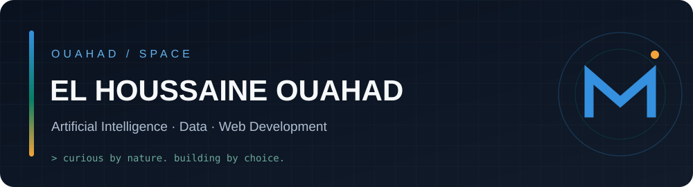

<div align="center">



<br/>

[](https://www.ouahad.space/)
[](https://github.com/Houssin-jsk?tab=repositories)

</div>

### `> whoami`

```text
name      El Houssaine Ouahad
based_in  Tangier, Morocco
focus     Artificial Intelligence / Data / Web Development
mindset   Stay curious. Question assumptions. Build and learn.
space     https://www.ouahad.space
```

### A little about me

I'm a technology enthusiast who enjoys connecting ideas across **AI, Data and Web Development**. My curiosity started with computers and networks, and grew into building applications, exploring data, and experimenting with intelligent systems.

I like understanding *why* things work, trying different approaches, and turning interesting problems into useful projects. I'm always learning — not claiming to know everything.

### Selected work

| Project | What it's about |
| :--- | :--- |
| **[MaisonDeLUX](https://www.maison-delux.com/)** | Exploring real-estate data and property price estimation in Morocco |
| **[YOUFTEN SELKHIR](https://youften-slkhir.com/)** | A web presence for a Moroccan honey brand |
| **[OUAHAD SPACE](https://www.ouahad.space/)** | My personal home for projects, experiments and ideas |

### What I work with

`Python` · `Pandas` · `SQL` · `Power BI` · `Excel` · `Next.js` · `TypeScript` · `Git`

---

<div align="center">

**Curiosity is the starting point. The rest is built.**

[**Enter OUAHAD SPACE ↗**](https://www.ouahad.space/)

</div>
